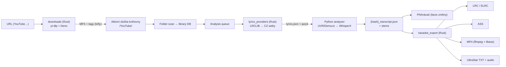

# Nightingale CZ – detailní plán implementace

5. 11. 2026 · navazuje na dokument „Lokální karaoke aplikace – plán projektu“

Tento dokument převádí projektový plán na konkrétní kroky v kódu tohoto forku (`dospe/nightingale-mp4-cz`, upstream `rzru/nightingale`, výchozí bod commit `5963fa8`). Každý milník uvádí soubory, které se mění, nové moduly, příkazy, datové typy a kritéria převzetí.

---

## 0. Shrnutí rozhodnutí

| Oblast | Rozhodnutí | Důvod |
| --- | --- | --- |
| Základ | Fork Nightingale, vlastní vývoj, pravidelné slučování s upstreamem | Podle původního plánu |
| Stahování | yt-dlp ukládá do **aktivní složky knihovny** (podsložka `YouTube/`), potom proběhne přescanování | Nightingale má vždy jen jeden aktivní zdroj (`AppConfig.library_source`); se zdrojem Plex, Jellyfin nebo Navidrome se tlačítko nezobrazí |
| Obraz | Stahuje se **video i zvuk** (MP4, H.264 do 1080p). Když web video nenabízí, uloží se jen zvuk | Video slouží jako pozadí při přehrávání i v MP4 exportu |
| Exporty (v1) | **LRC + Enhanced LRC, ASS (karaoke `\kf`), MP4 video, UltraStar TXT** | Všechny čtyři formáty |
| Texty | Řetězec zdrojů LRCLIB → české servery → přepis Whisperem, implementovaný v Rustu vedle stávajícího LRCLIB kódu | LRCLIB je v Rustu (`app-core/src/lyrics.rs`), ne v Pythonu |
| Kde žije kód | Nové moduly + co nejmenší „háčky“ do souborů z upstreamu | Méně konfliktů při slučování |
| Plán | Tento soubor v repozitáři | Rozhodnutí z 5. 11. 2026 |

### 0.1 Opravy původního plánu podle skutečného kódu

| Původní plán | Skutečnost v repozitáři | Dopad |
| --- | --- | --- |
| Python analyzer ve `vendor/analyzer` | Je v `app-core/analyzer/*.py`. Do binárky se vkládá přes `include_str!` (`app-core/src/vendor_scripts.rs`) a při startu se rozbalí do vendor složky | Nové `.py` soubory je nutné zaregistrovat ve `vendor_scripts.rs` |
| LRCLIB je krok Python pipeline | LRCLIB volá Rust: `lyrics::fetch_lrclib_lyrics()` z `analyzer::process_song()` (`app-core/src/analyzer.rs:886`). Python dostane jen cestu k `lyrics.json` | České zdroje patří do Rustu |
| Výstup `words.json` | Výstup je `{hash}_transcript.json` v cache (`CacheDir::transcript_path`). Obsahuje segmenty `{text, start, end, words:[{word, start, end, score?}]}` a navíc `language`, `source`, `key`, `tempo` | Exportéry čtou tento soubor |
| Rust 1.85, Node 20 | Rust **1.94.1** (`rust-toolchain.toml`), Node **≥ 22.12**, pnpm **11.2.2** | Upravit M0 |
| Export je třeba napsat celý | Export `.nge` už existuje (`app-core/src/song_export.rs`, příkaz `export_song_nge`), včetně výběru složky na desktopu a stažení souboru ve webovém režimu | Nové exporty použijí stejný mechanismus |
| Plugin API není | Platí. Navíc `app-api` má jediný `match` přes názvy příkazů (`app-api/src/lib.rs:336`) | Fork přidá vlastní sub-dispatcher (kap. 2.2) |
| Testy | Pravidla repozitáře **zakazují automatické Rust testy** (`.rulesync/rules/30-rust.md`). Kontroluje se přes fmt, check, clippy a deny | Ověřování přes `examples/` a ruční checklisty (kap. 7) |
| UI v češtině | UI katalogy jsou jen `en`, `de`, `zh-cn`. Seznam jazyků písní ale `cs` už obsahuje (`client/src/features/lyrics/lib/languages.ts`) | Přidán milník M6 |
| yt-dlp „jen přibalit“ | Od yt-dlp 2025.11 potřebuje plná podpora YouTube **externí JS runtime (Deno)** a balíček `yt-dlp-ejs` | Vendor bootstrap stahuje i Deno (M1) |

---

## 1. Cílová architektura



### 1.1 Nové moduly

| Modul | Vrstva | Obsah |
| --- | --- | --- |
| `app-core/src/downloads/` | app-core | `mod.rs` (veřejné API, fronta úloh), `bootstrap.rs` (instalace a aktualizace yt-dlp a Deno), `ytdlp.rs` (sestavení argumentů, parsování průběhu), `metadata.rs` (čištění názvů z YouTube), `tagging.rs` (zápis tagů a obalu přes `lofty`) |
| `app-core/src/lyrics_providers/` | app-core | `mod.rs` (trait `LyricsProvider`, řetězec zdrojů, výběr kandidáta), `karaoketexty.rs` a další scrapery, `normalize.rs` (rozbalení refrénů, odstranění poznámek a akordů), `matching.rs` (podobnost interpreta a názvu), `lang.rs` (detekce jazyka textu) |
| `app-core/src/karaoke_export/` | app-core | `mod.rs` (API `export_song`), `transcript.rs` (typovaný model transcriptu pro čtení), `lrc_writer.rs`, `ass_writer.rs`, `video.rs` (ffmpeg render), `ultrastar.rs`, `pitch.rs` (odhad výšky tónu), `naming.rs` (bezpečné názvy souborů) |
| `app-api/src/fork.rs` | app-api | Sub-dispatcher příkazů forku (kap. 2.2) |
| `client/src/bridge/downloads.ts`, `client/src/bridge/karaoke-export.ts` | klient | Typované volání příkazů a poslech událostí |
| `client/src/features/downloads/` | klient | Dialog stažení, seznam úloh, hooky |
| `client/src/features/karaoke-export/` | klient | Dialog exportu, průběh |
| `client/src/i18n/translations/fork/*.json` | klient | Překlady forku oddělené od upstreamu (kap. 2.3) |
| `app-core/examples/*.rs` | vývoj | Ruční ověřovací nástroje (kap. 7) |

### 1.2 Háčky do souborů z upstreamu

Udržovat aktuální seznam v `docs/fork/FORK.md`. Při slučování s upstreamem se konflikty řeší jen v těchto místech.

| Soubor | Změna | Milník |
| --- | --- | --- |
| `app-core/src/lib.rs` | `mod downloads; mod lyrics_providers; mod karaoke_export;` + `pub use` | M1–M5 |
| `app-core/src/config.rs` | nová volitelná pole `AppConfig` (kap. 6.1) + přístupové metody | M1–M4 |
| `app-core/src/analyzer.rs` (`process_song`) | volání `fetch_lrclib_lyrics` → `lyrics_providers::fetch_auto`, předání jazyka | M2 |
| `app-core/src/vendor.rs` | `uv_path()` → `pub(crate)`; jinak beze změny (bootstrap stahovače je vlastní modul) | M1 |
| `app-core/src/song_export.rs` | `resolve_stem_files` → `pub(crate)` | M4 |
| `app-core/Cargo.toml` | nové závislosti (kap. 6.3) | M2, M5 |
| `app-api/src/lib.rs` | poslední větev `_ =>` v `dispatch` volá `fork::dispatch(...)` | M1 |
| `client/src/features/sources/hooks/use-source-buttons.ts` | tlačítko „Stáhnout z internetu“ (jen pro zdroj Složka) | M1 |
| `client/src/features/menu/hooks/use-dialog.ts`, `client/src/features/menu/menu.tsx` | nové režimy dialogů `download`, `karaoke-export` | M1, M3 |
| `client/src/features/library/components/song-details/song-actions.ts` | skupina Export: „Exportovat karaoke…“ vedle `.nge` | M3 |
| `client/src/features/lyrics/components/index.tsx` | záložka `czech` vedle `edit` a `lrclib` | M2 |
| `client/src/features/settings/settings.tsx` + `components/constants.ts` | sekce „Stahování“, „Zdroje textů“, „Export“ | M1–M4 |
| `client/src/i18n/index.ts` | sloučení katalogů forku, registrace `cs` | M1, M6 |
| `client/src-tauri/tauri.conf.json`, ikony, `.github/workflows/release.yml` | branding, identifier, updater | M0, M7 |

---

## 2. Společné technické vzory

### 2.1 Přidání příkazu (end-to-end)

1. **app-core**: funkce ve vlastním modulu, `pub use` v `app-core/src/lib.rs`. DTO typy mají `#[derive(Serialize, Deserialize, TS)] #[ts(export)]` a TS typy se generují do `client/src/types/` (ts-rs v12, `TS_RS_EXPORT_DIR` v `.cargo/config.toml`).
2. **app-api**: větev v `fork::dispatch` s lokální strukturou `Args` (`#[serde(rename_all = "camelCase")]`). Blokující práci spouštět přes `tokio::task::spawn_blocking`, dlouhé úlohy ve vlastním vlákně s událostmi `events.emit("…", &payload)` (vzor `shift-key-done` v `app-api/src/lib.rs`).
3. **Tauri a server adaptér**: beze změny. `dispatch_command` i `POST /api/cmd/:name` přeposílají libovolný název příkazu.
4. **Klient**: funkce v `client/src/bridge/<oblast>.ts` přes `invoke<T>('name', {…})`, události přes `listen<T>('event', cb)` z `./runtime`, validace odpovědí přes zod (vzor `bridge/lyrics.ts`).
5. **Telefonní ovladač**: příkazy forku do `REMOTE_COMMANDS` nepřidávat (mimo rozsah v1).

### 2.2 Sub-dispatcher forku

```rust
// app-api/src/lib.rs – jediná změna v dispatch()
_ => fork::dispatch(state, name, payload).await,

// app-api/src/fork.rs
pub(crate) async fn dispatch(state: CommandState, name: &str, payload: Value) -> CmdResult {
    match name {
        "downloader_status" => { … }
        // …
        _ => Err(CommandError { status: 404, message: format!("unknown command: {name}") }),
    }
}
```

Chování neznámého příkazu zůstane stejné (404). Nové příkazy forku nepřinášejí konflikty v `lib.rs`.

### 2.3 Překlady

- `client/src/i18n/index.ts` typuje katalogy jako `Record<TranslationKey, string>`, takže každý klíč musí být ve všech katalozích, jinak selže `tsc`.
- Klíče forku dávat do `translations/fork/{en,de,zh-cn,cs}.json` pod prefix `fork.*` a v `index.ts` je sloučit se základním katalogem (`{...base, ...fork}`). Pro `de` a `zh-cn` stačí anglický text.
- Pravidlo repozitáře: každý viditelný text patří do `en.json` (pro fork do `fork/en.json`).

### 2.4 Dlouhé úlohy (stahování, export)

- Každá oblast má vlastní frontu a jedno pracovní vlákno (stahování a export běží zvlášť, analýza má svoji frontu).
- Stav úlohy: `Queued → Running{phase, pct} → Done{…} | Failed{message} | Cancelled`, s ID jako neprůhledným řetězcem (UUID).
- Události: `<oblast>-progress` (omezit na nejvýš 4 za sekundu) a `<oblast>-finished`. Příkaz `load_<oblast>_jobs` vrací stav pro klienta, který se připojí později. Ve webovém režimu jdou události přes WebSocket `/ws`.
- Zrušení: `Child::kill()` na procesu yt-dlp nebo ffmpeg, smazání `.part` a dočasných souborů.
- Logy podle pravidel (`40-security-domain.md`): logovat jen ID úloh a kódy chyb, ne URL, názvy skladeb ani texty.

---

## 3. Přehled milníků

| # | Milník | Odhad | Závisí na | Paralelní větev |
| --- | --- | --- | --- | --- |
| M0 | Příprava forku, branding, ověření předpokladů | 3–4 dny | – | – |
| M1 | Stahování přes yt-dlp | 6–8 dní | M0 | A |
| M2 | České texty + kvalita zarovnání v češtině | 7–9 dní | M0 | A |
| M3 | Export LRC, ELRC, ASS + dialog exportu | 5–6 dní | M0 | B |
| M4 | MP4 karaoke video | 4–5 dní | M3 | B |
| M5 | UltraStar TXT (s výškou tónu) | 5–7 dní | M3 | B |
| M6 | Čeština v UI (`cs`) | 2–3 dny | M1–M5 (texty) | – |
| M7 | Vydání (Windows, macOS, self-hosted) | 3–4 dny | vše | – |
| | **Celkem** | **35–46 dní ≈ 7–9 týdnů** pro jednoho vývojáře; se dvěma (větve A a B) zhruba 5 týdnů | | |

Původní odhad (5,5 týdne) nepočítal s UltraStar exportem, s češtinou v UI ani s instalací Deno.

---

## M0 – Příprava forku (3–4 dny)

### Úkoly

1. **Upstream a build**
   - `git remote add upstream https://github.com/rzru/nightingale.git`. Vývoj probíhá ve větvi forku, upstream se slučuje do `master` jednou měsíčně a před každým vydáním.
   - Sestavit podle README: `pnpm --dir client install --frozen-lockfile`, `cargo desktop dev` na Windows i macOS (Apple Silicon). Projít první spuštění (vendor setup: ffmpeg, uv, Python, venv, balíčky, modely).
   - Založit `docs/fork/FORK.md`: seznam háčků (kap. 1.2), postup slučování, nová konfigurační pole.
2. **Branding a oddělení od upstreamu** (dřív než se nainstaluje první build mimo vývojáře)
   - `client/src-tauri/tauri.conf.json`: `productName`, `identifier` (např. `cz.<vlastník>.nightingale-cz`). Upstream má `com.rzru.client`, a stejný identifier by sdílel data aplikace a koncové body updateru.
   - Updater: `plugins.updater.endpoints` přesměrovat na releases forku a vygenerovat **vlastní** klíčový pár (`pnpm tauri signer generate`). Bez toho by se instalace forku automaticky aktualizovala na upstream verzi a přišla o funkce forku.
   - Datová složka: zvážit jiný výchozí název než upstream (`app-core/src/cache.rs`, `default_nightingale_dir`). Pokud by obě aplikace sdílely `config.json`, upstream by při ukládání zahodil pole forku.
   - Ikony (`client/src-tauri/icons/`), logo v klientu, odkazy v README.
3. **Ověření předpokladů** (výstupem je krátký zápis do `docs/fork/overeni-M0.md`)
   - **libass v přibaleném ffmpeg** na všech platformách: `ffmpeg -hide_banner -filters | grep -E " ass | subtitles "` pro buildy z `vendor.rs` (johnvansickle pro Linux, evermeet pro macOS, BtbN pro Windows). Bez libass M4 nepůjde.
   - **Zarovnání pro češtinu**: zjistit, jaký model WhisperX pro `cs` načte (`whisperx.alignment.DEFAULT_ALIGN_MODELS_HF`). Kandidát je `comodoro/wav2vec2-xls-r-300m-cs-250` (Apache-2.0). Ověřit pokrytí znaků `á č ď é ě í ň ó ř š ť ú ů ý ž` ve slovníku modelu. Qwen aligner češtinu nepodporuje (`qwen_align.SUPPORTED_LANGS`) a kód sám přejde na wav2vec2 (`align.py`).
   - **Detekce jazyka**: na 10 českých písních zjistit, jak často `detect_language_multiwindow` vrátí `sk`, `pl` nebo `sl` místo `cs`.
   - **Výkon**: změřit dobu analýzy jedné 4minutové písně pro `large-v3`, `large-v3-turbo` a `medium` na běžném Windows notebooku (CPU) a na MacBooku M1–M4. Podle výsledku nastavit doporučený výchozí model.
   - **České weby s texty**: pro karaoketexty.cz, texty.cz a lyrics.cz (záložně supermusic.cz, pisnicky-akordy.cz) ověřit, že jsou dostupné, mají vyhledávání přes URL a jakou strukturu HTML má stránka s textem. Zkontrolovat `robots.txt` a podmínky použití. Weby, které automatický přístup zakazují, nepoužívat.
   - **yt-dlp**: v čistém venv ověřit `pip install "yt-dlp[default]"` + Deno a stažení 3 videí (YouTube klip, YouTube Music, SoundCloud).
4. **Testovací sada**: 10 českých a 10 anglických písní (pop, rock, rap, sbor, živá nahrávka). Uložit seznam URL a očekávané výsledky do `docs/fork/testovaci-sada.md`. Média ani texty do repozitáře nedávat.

### Kritéria převzetí

- Build na Windows i macOS projde, `pnpm --dir client quality` je zelené.
- Aplikace forku běží vedle upstream Nightingale, aniž by si sahaly na data, a updater míří na fork.
- `overeni-M0.md` obsahuje výsledky všech ověření a rozhodnutí o výchozím Whisper modelu a o seznamu českých webů.

---

## M1 – Stahování z YouTube a dalších webů (6–8 dní)

### 1.1 Instalace stahovače (`downloads/bootstrap.rs`)

Stahovač se instaluje **líně**, až při prvním použití. Základní setup se tím neprodlouží a `SetupStep` v `vendor.rs` zůstane beze změny.

| Krok | Implementace |
| --- | --- |
| yt-dlp | `uv pip install --python <venv python> "yt-dlp[default]"` (balíček `default` přidá `yt-dlp-ejs`, `mutagen` a další). Spouští se jako `<venv python> -m yt_dlp` |
| Deno | Stáhnout oficiální zip z GitHub Releases `denoland/deno` pro danou platformu (`x86_64-pc-windows-msvc`, `aarch64-apple-darwin`, `x86_64-apple-darwin`, `x86_64-/aarch64-unknown-linux-gnu`), **ověřit SHA-256** proti publikovanému `.sha256sum` a rozbalit do `vendor/deno/`. Použít `download_to_file` a `extract_archive` z `vendor.rs` (zpřístupnit jako `pub(crate)`) |
| Marker | `vendor/.downloader_ready` s verzemi yt-dlp a Deno. Smaže se spolu s vendor složkou (`clear_vendor_dir`) |
| Aktualizace | Příkaz `downloader_update`: `uv pip install -U "yt-dlp[default]"`, případně novější Deno. Tlačítko v Nastavení → Stahování |

Průběh instalace hlásí událost `downloader-progress` (`{phase, pct}`).

### 1.2 Průběh stažení (`downloads/mod.rs`, `ytdlp.rs`)

1. **Probe** (`download_probe {url}`): `python -m yt_dlp --ignore-config --dump-single-json --no-playlist --use-extractors default,-generic -- <url>`. Vrací `DownloadProbe { title, artist_guess, title_guess, duration_secs, thumbnail_url, has_video, extractor, id, is_live }`.
2. **Uživatel potvrdí** interpreta a název (předvyplněné, editovatelné).
3. **Stažení** (`download_start`), argumenty jako `Vec<OsString>`, nikdy ne řetězec pro shell:
   ```text
   --ignore-config --no-playlist --use-extractors default,-generic
   --js-runtimes deno:<vendor>/deno/deno            # přesný název volby ověřit pro aktuální yt-dlp
   --ffmpeg-location <vendor ffmpeg>
   -f "bv*[vcodec^=avc1][height<=1080]+ba[ext=m4a]/b[ext=mp4]/bv*[height<=1080]+ba/b"
   --merge-output-format mp4
   --match-filters "duration<=1200 & !is_live" --max-filesize 2G
   --write-thumbnail --convert-thumbnails jpg
   --download-archive <library>/YouTube/.nightingale-archive.txt
   --windows-filenames --no-mtime --newline
   --progress-template "download:NGDL %(progress.downloaded_bytes)s/%(progress.total_bytes,progress.total_bytes_estimate)s"
   --print after_move:filepath
   -o "<library>/YouTube/%(id)s.%(ext)s"   # dočasný název, přejmenování v kroku 4
   -- <url>
   ```
   - Upřednostňuje se H.264 (`avc1`), protože `playback.rs` jinak video překóduje (`ensure_playable_source_video`) a AV1 nebo VP9 ve WebKitu (macOS) nemusí jít přehrát.
   - Když web video nenabízí (`has_video == false`), použije se `-f ba/b -x --audio-format m4a`.
4. **Dokončení** (`tagging.rs`):
   - Přejmenovat na `<Interpret> - <Název> [<id>].mp4`: bezpečné znaky pro Windows, délka nejvýš 150 znaků, při kolizi přidat ` (2)`. Diakritika zůstává.
   - Přes `lofty` (už je v závislostech) zapsat tagy `title`, `artist`, `album` (pokud je), komentář `Zdroj: <extractor>:<id>` a obal (`.jpg` z yt-dlp, který se pak smaže).
   - Cílová cesta po kanonikalizaci **musí ležet uvnitř** aktivní složky knihovny (ochrana proti traversal a symlinkům).
5. **Zařazení do knihovny**: v1 spustí `trigger_scan` (scan složky). Pokud se ukáže, že je na velkých knihovnách pomalý, doplnit `library_db::upsert_single_song` + `FolderSource::index_file(path)` (využije `classify_media_file` a `Song::from_path`). Když je zapnuté `auto_analyze`, píseň se zařadí do analýzy (`enqueue_one`).

### 1.3 Čištění metadat (`downloads/metadata.rs`)

Pořadí zdrojů pro interpreta a název:

1. Pole `artist` a `track` z yt-dlp (vyplněná u YouTube Music a některých oficiálních kanálů).
2. Kanál `"<Interpret> - Topic"` dává interpreta, název je pak `title`.
3. Rozdělení `title` podle prvního ` - `, ` – ` nebo ` | `.
4. Odstranit přívěsky (bez ohledu na velikost písmen, v závorkách i bez nich): `official video|audio|music video|lyric video|lyrics|videoclip|oficiální klip|official|HD|4K|remastered 20xx|visualizer`. `feat.` a `ft.` přesunout do interpreta.
5. Záloha: interpret je `uploader`, název je `title`.

Stejný normalizátor použijí i vyhledávače textů (M2), proto patří do sdíleného místa (`lyrics_providers::matching` ho reexportuje).

### 1.4 Bezpečnost

- URL přijímat jen se schématem `http(s)`, délkou do 2 kB a bez znaků konce řádku. Vždy předávat za `--`, aby URL začínající `-` nebyla brána jako volba.
- `--use-extractors default,-generic` vypne obecný extraktor: yt-dlp pak nestáhne libovolnou URL, jen podporované weby. To omezuje SSRF v self-hosted režimu.
- `--ignore-config`: globální konfigurace yt-dlp uživatele nesmí měnit chování ani výstup.
- V self-hosted režimu přidat konfigurační přepínač `downloads_enabled` (výchozí `true` na desktopu, `false` na serveru, dokud ho správce nezapne).
- Příkaz odmítne požadavek (400 `downloads.requiresFolderSource`), když aktivní zdroj není Složka.

### 1.5 Příkazy a události

| Příkaz | Argumenty | Výsledek |
| --- | --- | --- |
| `downloader_status` | – | `{ installed, ytDlpVersion?, denoVersion? }` |
| `downloader_install` / `downloader_update` | – | `()`; průběh přes `downloader-progress` |
| `download_probe` | `{ url }` | `DownloadProbe` |
| `download_start` | `{ url, artist, title }` | `{ jobId }` |
| `download_cancel` | `{ jobId }` | `()` |
| `load_download_jobs` | – | `DownloadJob[]` |

Události: `download-progress {jobId, phase: "fetching"|"downloading"|"merging"|"tagging"|"indexing", pct}`, `download-finished {jobId, status, fileHash?, error?}`.

### 1.6 UI (`client/src/features/downloads/`)

- Tlačítko „Stáhnout z internetu“ v postranním panelu a na obrazovce prázdné knihovny. Zobrazuje se jen pro zdroj Složka (`getSource(config, 'folder')`).
- Dialog (`DialogMode` `download`):
  1. pole URL s vložením ze schránky,
  2. náhled (miniatura, délka, předvyplněný interpret a název),
  3. tlačítko Stáhnout,
  4. seznam úloh s průběhem, Zrušit a Otevřít píseň.
- Při prvním použití dialog nabídne instalaci stahovače (cca 150 MB) s průběhem.
- Nastavení → Stahování: podsložka (výchozí `YouTube`), max. výška videa (720/1080), tlačítko „Aktualizovat stahovač“ s verzí.
- Ovládání klávesnicí a gamepadem podle stávajících dialogů (`use-dialog-nav.ts`).

### Kritéria převzetí M1

- Na Windows i macOS stažení YouTube klipu vytvoří `YouTube/<Interpret> - <Název> [id].mp4` se správnými tagy a obalem. Píseň se objeví v knihovně, projde analýzou a přehraje se s videem na pozadí.
- Opakované stažení stejné URL se přeskočí (download archive) a uživatel dostane srozumitelnou hlášku.
- Zrušení během stahování nezanechá ve složce knihovny `.part` soubory.
- Neplatná URL, živý přenos, příliš dlouhé video nebo zdroj Plex vedou k přeloženým chybovým hláškám, ne k pádu.
- `pnpm --dir client quality` a `cargo deny check` projdou.

---

## M2 – České texty a zarovnání v češtině (7–9 dní)

### 2.1 Řetězec zdrojů (`lyrics_providers/mod.rs`)

```rust
pub(crate) trait LyricsProvider: Send + Sync {
    fn id(&self) -> LyricsProviderId;                       // "lrclib" | "karaoketexty" | …
    fn search(&self, q: &LyricsQuery) -> Result<Vec<ExternalLyricsCandidate>, ProviderError>;
    fn fetch(&self, c: &ExternalLyricsCandidate) -> Result<FetchedLyrics, ProviderError>;
}

#[derive(Serialize, Deserialize, TS)] #[ts(export)]
pub struct ExternalLyricsCandidate {
    pub provider: LyricsProviderId,
    pub track_name: String,
    pub artist_name: String,
    pub url_id: String,            // neprůhledné ID detailu, ne URL pro klienta
    pub score: f32,                // shoda s písní 0–1
    pub lines: Vec<String>,        // vyplněno po fetch
    pub detected_language: Option<String>,
}
```

- `fetch_auto(song, cache) -> Option<FetchedLyricsFile>` nahradí v `analyzer::process_song` volání `fetch_lrclib_lyrics`:
  1. Pokud už `lyrics.json` existuje, použije se (stejně jako dnes).
  2. Zkusí se zdroje v pořadí `AppConfig.lyrics_provider_order` (výchozí `["lrclib", "karaoketexty", …]`). LRCLIB se volá přes stávající `lrclib_candidates`, jeho kód se nemění.
  3. Vybere se první kandidát se `score ≥ 0.85`. Na hraniční shodu (0.6–0.85) se v automatickém režimu nesahá, kandidát se jen nabídne v editoru.
  4. Výsledek uloží `write_lyrics_file` a do `{hash}_lyrics_source.json` se zapíše `{provider, fetched_at}`. Do UI se zobrazí původ textu („Text: karaoketexty.cz“).
- Heuristika pořadí (volitelná, `lyrics_czech_first_heuristic`): když interpret nebo název obsahuje znaky `ěščřžůňťď`, zkusí se české zdroje před LRCLIB.

### 2.2 Scrapery

- HTTP přes `ureq`, jak už to dělá LRCLIB. User-Agent `Nightingale-CZ/<verze>` bez osobních údajů. Timeout 10 s, nejvýš 1 požadavek za sekundu na doménu, odpovědi vyhledávání cachovat 7 dní v `cache/lyrics_http/`.
- HTML parsovat crate `scraper`. CSS selektory držet v konstantách na začátku souboru každého scraperu, aby se při změně webu daly rychle opravit.
- **Překlady**: české weby často zobrazují originál a vedle něj český překlad. Scraper smí vzít **jen originál** (selektor sloupce originálu, ověřený v M0).
- Chyby (změna struktury, 403, 429) vracejí `ProviderError` a řetězec pokračuje dalším zdrojem. Chyba se loguje bez textu písně.
- Texty jsou jen pro osobní použití a nikam se nepřeposílají (viz Rizika).

### 2.3 Normalizace textu (`lyrics_providers/normalize.rs`)

Zobrazovaný text zůstává věrný zdroji. Normalizace řeší jen strukturu, aby zarovnání dostalo text, který odpovídá nahrávce:

| Problém v českých textech | Úprava |
| --- | --- |
| Refrén napsaný jednou, dál jen značka `R:`, `Ref.:`, `Refrén:`, `[R]` | Blok za první značkou uložit jako refrén a každou další holou značku nahradit celým blokem |
| Opakování `(2x)`, `2x`, `/: … :/` | Rozbalit na skutečný počet opakování |
| Číslování slok `1.`, `2.`, `Sloka 1:` | Odstranit značku, text ponechat |
| Akordy (weby se zpěvníky) | Odstranit řádky, které obsahují jen akordy, a akordy v hranatých závorkách |
| Poznámky `[instrumentál]`, `(sólo)`, `*` | Odstranit |
| HTML entity, `<br>`, nezlomitelné mezery, CRLF | Normalizovat |

Pro porovnávání (ne pro zobrazení) se používá NFD bez diakritiky (`unicode-normalization` už je v závislostech).

### 2.4 Shoda kandidáta (`matching.rs`)

- `score = 0.6 · sim(title) + 0.4 · sim(artist)`, kde `sim` je Jaro-Winkler (crate `strsim`) nad normalizovanými řetězci: malá písmena, bez diakritiky, bez přívěsků z M1, bez `feat.`.
- Pokud zdroj zná délku písně, rozdíl nad 15 s dává penalizaci.

### 2.5 Jazyk

- **Jazyk textu**: crate `whatlang` na textu kandidáta (rozliší `ces`, `slk`, `eng`). Výsledek se předá analyzeru jako `language` hint v `cmd_json` (`analyzer.rs`, větev `language_hint`). Odpadne tím chybná detekce `sk` nebo `pl` u písní, které mají text.
- **Výchozí jazyk přepisu** (nové `AppConfig.default_transcription_language`: `auto` | `cs` | `en`; výchozí `auto`). Použije se, když píseň nemá vlastní override a text není k dispozici. Pořadí zůstává: override písně (`language_overrides`) → jazyk textu → výchozí jazyk → automatická detekce.
- Volitelně, pokud M0 ukáže časté záměny: v `language.py` při `auto` a preferovaném `cs` přemapovat `sk` s nízkou jistotou na `cs`. Jen jako explicitní nastavení, ne skryté pravidlo.

### 2.6 Zarovnání pro češtinu (Python)

- Pokud WhisperX pro `cs` nemá výchozí model nebo se ukáže jako slabý, přidat mapování vedle `cjk.align_model_for` (nový soubor `app-core/analyzer/align_models.py` s `{"cs": "<model z M0>"}`) a zaregistrovat ho ve `vendor_scripts.rs`.
- Před zarovnáním odstranit číslice a znaky mimo slovník modelu (podobně jako `cjk.py` u ja/zh). Zobrazovaný text se nemění.
- **Metrika kvality zarovnání** (v Rustu, bez změny formátu transcriptu): z `words[].score` spočítat podíl slov se `score < 0.3` nebo bez času. Nad prahem (kalibrace na testovací sadě, počáteční odhad 35 %) ukázat v detailu písně upozornění „Text možná neodpovídá nahrávce“ s akcí „Vynutit přepis“ (stávající `reanalyze_force_transcribe`). Tím se řeší riziko z původního plánu (jiná verze nebo živá nahrávka).

### 2.7 UI

- Editor textů (`client/src/features/lyrics/components/index.tsx`): nová záložka `czech` („České servery“) se seznamem kandidátů ze všech českých zdrojů (zdroj, interpret, název, shoda). Náhled textu a „Použít“ volá stávající `save_lyrics`, které text zarovná znovu.
- Detail písně ukáže původ textu a případné upozornění na kvalitu.
- Nastavení → Zdroje textů: zapnutí a vypnutí jednotlivých zdrojů, pořadí, heuristika „české zdroje nejdřív“, výchozí jazyk přepisu, doporučený Whisper model podle M0.

### 2.8 Příkazy

| Příkaz | Argumenty | Výsledek |
| --- | --- | --- |
| `search_external_lyrics` | `{ fileHash, providers? }` | `ExternalLyricsCandidate[]` (bez `lines`) |
| `fetch_external_lyrics` | `{ fileHash, provider, urlId }` | `ExternalLyricsCandidate` (s `lines`) |
| `load_lyrics_origin` | `{ fileHash }` | `{ provider?, alignmentWarning? }` |

### Kritéria převzetí M2

- Z 10 českých písní testovací sady najde automatický řetězec text aspoň u 7. U nalezených textů je v průměru ≥ 85 % slov se `score ≥ 0.3` a refrény se rozbalují správně.
- U anglických písní se chování LRCLIB nezmění (stejný výsledek jako upstream).
- Výpadek českého webu (simulovaný špatný selektor) analýzu nezastaví: pokračuje přepis Whisperem.
- V logu nejsou žádné texty písní.

---

## M3 – Export LRC, Enhanced LRC a ASS (5–6 dní)

### 3.1 Vstup (`karaoke_export/transcript.rs`)

- Číst `cache.transcript_path(hash)`, tedy transcript v **původním tempu** (tempo 1.0). Varianty pro změněné tempo (`variant_transcript_path`) export nepoužívá.
- Typovaný read model:
  ```rust
  pub(crate) struct ExportTranscript { pub language: Option<String>, pub segments: Vec<ExportLine> }
  pub(crate) struct ExportLine { pub text: String, pub start: f64, pub end: f64, pub words: Vec<ExportWord> }
  pub(crate) struct ExportWord { pub text: String, pub start: f64, pub end: f64 }
  ```
  Validace: časy musí být konečná nezáporná čísla, `start ≤ end`, monotónní v rámci řádku. Řádky bez slov (LRC na úrovni řádků) dostanou jedno „slovo“ přes celý řádek. Chybné hodnoty dávají `NightingaleError`, žádný tichý odhad (`40-security-domain.md`: neměnit význam časování).
- Metadata pro hlavičky: `Song` z `library_db::load_song_by_hash` (title, artist, album, duration).

### 3.2 LRC a Enhanced LRC (`lrc_writer.rs`)

- Hlavička: `[ti:]`, `[ar:]`, `[al:]`, `[length: mm:ss]`, `[re:Nightingale CZ]`, `[ve:<verze>]`.
- Časová značka `[mm:ss.xx]`: zaokrouhlit **jednou** na setiny z absolutního času, aby `59.999 s` nedalo `00:60.00`. Délky nad 99 minut odmítnout.
- **LRC**: `[start]text řádku`. Mezera mezi řádky nad 8 s dostane prázdný řádek `[konec předchozího + 0.5 s]`, aby přehrávače smazaly text.
- **Enhanced LRC (A2)**: `[start]<t1>slovo <t2>slovo … <konec>`. Poslední značka nese konec řádku.
- Ověření kruhem: exportovaný soubor načíst stávajícím `lrc::parse_lrc` (import) a porovnat časy s tolerancí ±10 ms (nástroj `examples/export_roundtrip.rs`, kap. 7).

### 3.3 ASS (`ass_writer.rs`)

- `[Script Info]`: `ScriptType: v4.00+`, `PlayResX: 1920`, `PlayResY: 1080`, `WrapStyle: 2`, `ScaledBorderAndShadow: yes`, `YCbCr Matrix: TV.709`.
- `[V4+ Styles]`:
  - `Karaoke`: písmo z kap. 3.4, velikost 72, `PrimaryColour` (už zazpívané) a `SecondaryColour` (čeká), obrys 4, stín 2, `Alignment 2` (dole uprostřed).
  - `Title`: úvodní titulek interpret a název.
- **Rozvržení na dva řádky**, jak je zvykem u karaoke: lichý řádek nahoře, sudý dole, aby byl další řádek vidět předem. Událost řádku začíná `max(start − 1.5 s, konec řádku o dva výš)` a končí `end + 0.3 s`.
- **Časování slov**: `{\kf<cs>}` (plynulé vybarvení). Délky v setinách se počítají z **absolutních** zaokrouhlených časů (`k_i = round(t_{i+1}·100) − round(t_i·100)`), takže chyba nenarůstá. Pauzy mezi slovy dostanou prázdný `{\k<gap>}`, náběh před prvním slovem `{\k<lead_in>}`.
- **Odpočet** před delší instrumentální pauzou (> 6 s): tři tečky `● ● ●`, které mizí po sekundách (volitelné, výchozí zapnuto).
- **Úvodní titulek** `Interpret – Název`, pokud zpěv začíná později než za 5 s.
- Escapování: `\` → `\\`, `{` a `}` nahradit (ASS je neumí escapovat) za `(` a `)`. Soubor zapisovat v UTF-8; české znaky libass zvládne, pokud je má písmo.
- Barvy a velikost písma volitelné v dialogu exportu (výchozí hodnoty podle motivu přehrávače).

### 3.4 Písmo

- Klient přibaluje jen `NotoSansCJKsc-Regular.otf`. Ověřit, že má české znaky. Pro export ale raději přibalit samostatné latinkové písmo s licencí OFL (např. Noto Sans Bold, cca 500 kB) do `app-core/assets/fonts/` přes `include_bytes!`. Při exportu se rozbalí do pracovní složky.
- Název písma v ASS musí přesně odpovídat internímu názvu rodiny v souboru.

### 3.5 Export – API a doručení souborů

```rust
#[derive(Deserialize, TS)] #[ts(export)]
pub struct KaraokeExportRequest {
    pub file_hash: String,
    pub formats: Vec<KaraokeExportFormat>,      // Lrc | Elrc | Ass | Mp4 | UltraStar
    pub ass_style: Option<AssStyleOptions>,
    pub video: Option<VideoExportOptions>,       // M4
}
```

- `karaoke_export_start { request, destDir? }` → `{ jobId }`. Cílová složka přes `CommandRuntime::resolve_export_directory`, stejně jako u `.nge`:
  - **desktop**: složka vybraná uživatelem (dialog z `opener`, po výběru `allow_directory`),
  - **web**: `exports_dir()/<jobId>/`. Při více souborech se vytvoří jeden ZIP (`zip` už je v závislostech) a klient ho stáhne přes `downloadWebExport` (`GET /api/asset?…&download=true`, soubor se po odeslání smaže).
- Názvy souborů `<Interpret> - <Název>.<ext>` (`naming.rs`): bezpečné znaky pro Windows, diakritika zůstává, při kolizi ` (2)`.
- Zápis atomicky přes `.part` a přejmenování (vzor `export_song_nge`).
- `karaoke_export_cancel { jobId }`, `load_karaoke_export_jobs`, události `karaoke-export-progress` a `karaoke-export-finished { jobId, status, paths?, error? }`.
- Dostupnost: hotová analýza a transcript. Na rozdíl od `.nge` i pro písně z Plexu, Jellyfinu a Navidrome, protože LRC a ASS potřebují jen cache. Pro USDX písně se nenabízí UltraStar (M5).

### 3.6 UI

- `song-actions.ts`, skupina Export: nová akce „Exportovat karaoke…“ otevře `DialogMode` `karaoke-export`.
- Dialog: zaškrtávátka formátů (LRC, Enhanced LRC, ASS, MP4, UltraStar). U ASS a MP4 sbalitelné volby vzhledu, u MP4 volby videa (M4). Tlačítko Exportovat, průběh, po dokončení „Otevřít složku“ (desktop) nebo automatické stažení (web).
- Poslední volby si pamatovat v `AppConfig.karaoke_export_defaults`.

### Kritéria převzetí M3

- LRC a ELRC se správně zobrazí ve VLC a foobar2000 (s doplňkem pro texty). ELRC projde zpětným importem do Nightingale v toleranci ±10 ms.
- ASS se v mpv a VLC vybarvuje synchronně se zpěvem (kontrola na 5 písních). Česká diakritika se vykreslí správně.
- Export funguje na desktopu i v self-hosted režimu.

---

## M4 – MP4 karaoke video (4–5 dní)

### 4.1 Vstupy

| Složka | Zdroj |
| --- | --- |
| Zvuk | Instrumentál pro detekovanou tóninu a tempo 1.0 (`resolve_stem_files` z `song_export.rs`). Volitelně průvodní zpěv: vokály ztlumené o −15 dB (`amix`) |
| Obraz | 1) zdrojové video písně (`song.is_video`, lokálně `song.path`, u vzdálených zdrojů `ensure_local_media`); 2) obal alba rozmazaný na celé ploše + ostrý obal uprostřed; 3) jednobarevné pozadí |
| Titulky | ASS z M3 (vygenerovaný do pracovní složky) |
| Písmo | `fonts/` v pracovní složce (kap. 3.4) |

Zvuk i obraz zdrojového videa pocházejí ze stejného souboru, takže časová osa sedí.

### 4.2 ffmpeg (`video.rs`)

- ffmpeg se spouští s `current_dir = pracovní složka` a filtr dostává **relativní** cesty (`ass=subs.ass:fontsdir=fonts`). Odpadne tím escapování cest v Windows (`C\:`) uvnitř filtrů.
- Příklad pro zdrojové video:
  ```text
  ffmpeg -y -i <video> -i <instrumental.mp3> [-i <vocals.mp3>]
    -filter_complex "[0:v]scale=1920:1080:force_original_aspect_ratio=decrease,
                     pad=1920:1080:(ow-iw)/2:(oh-ih)/2,setsar=1,fps=30,
                     ass=subs.ass:fontsdir=fonts[v];
                     [1:a]volume=0dB[i];[2:a]volume=-15dB[g];[i][g]amix=inputs=2:normalize=0[a]"
    -map "[v]" -map "[a]"
    -c:v libx264 -preset veryfast -crf 20 -pix_fmt yuv420p
    -c:a aac -b:a 192k -movflags +faststart -shortest
    -progress pipe:1 -nostats  out.mp4.part
  ```
- Obal: `-loop 1 -framerate 30 -i cover.jpg`, `scale…:increase,crop=1920:1080,boxblur=20:2,eq=brightness=-0.25` + `overlay` ostrého obalu, délka `-t <duration>`.
- Jednobarevné pozadí: `-f lavfi -i color=c=0x101018:s=1920x1080:r=30`.
- Průběh: parsovat `out_time_us` z `-progress` vůči délce písně a posílat událost `karaoke-export-progress`.
- Zrušení: `kill()` a smazání `.part`.
- Rozlišení 720p/1080p, preset `veryfast`/`medium`. Hardwarové kodéry (`h264_videotoolbox`, `h264_nvenc`) volitelně po detekci `ffmpeg -encoders`, se zálohou na `libx264`.
- Odhad času: 4minutová píseň v 1080p a presetu veryfast zabere na notebookovém CPU zhruba 1–3 minuty.

### Kritéria převzetí M4

- MP4 přehraje VLC, QuickTime, prohlížeč Chrome a chytrá TV (USB) a titulky jsou synchronní v toleranci ±50 ms.
- Funguje se všemi třemi pozadími. Cesty s diakritikou a mezerami na Windows nevadí.
- Zrušení renderu uklidí dočasné soubory.

---

## M5 – UltraStar TXT (5–7 dní)

### 5.1 Výška tónu (`karaoke_export/pitch.rs`)

- Vokální stopu dekódovat ffmpegem do PCM (`-f f32le -ac 1 -ar 22050 pipe:1`) a spočítat f0 algoritmem McLeod (crate `pitch-detection`). Je to stejný algoritmus, jaký používá klientské bodování (`pitchy` v `client/src/features/playback/lib/pitch/`), takže export odpovídá tomu, co Nightingale při zpěvu hodnotí. Okno 2048, krok 256, práh jasnosti a RMS brána podle `pitch/constants.ts`.
- Pro každé slovo: medián f0 přes rámce uvnitř `[start, end]` → MIDI → UltraStar pitch (`midi − 60`, tedy 0 = C4).
- Oktávové chyby: přeložit do ±6 půltónů od mediánu celé písně.
- Slovo bez spolehlivé výšky (rap, šepot) dostane **freestyle notu `F`**, žádnou smyšlenou výšku (`40-security-domain.md`: nejistá analýza se nesmí tvářit jako jistota).
- v1 dává jednu notu na slovo. Volitelně ve v1.1 rozdělit dlouhá slova na víc not (`~`), když se výška mění o více než 1 půltón déle než 150 ms.
- Záloha, pokud McLeod nebude stačit: torchcrepe v Python analyzeru (nový IPC příkaz `pitch_track`).

### 5.2 Soubor (`ultrastar.rs`)

- Formát 1.1.0, pro kompatibilitu se staršími přehrávači i hlavičky 1.0:
  ```text
  #VERSION:1.1.0
  #TITLE:… #ARTIST:… #LANGUAGE:Czech|English #CREATOR:Nightingale CZ
  #AUDIO:<Interpret> - <Název>.mp3   #MP3:(totéž, pro starší verze)
  #VOCALS:… #INSTRUMENTAL:… #VIDEO:… #COVER:…
  #BPM:… #GAP:<ms prvního beatu>
  ```
- BPM zvolit tak, aby jeden beat odpovídal 20–25 ms (`secs_per_beat = 60 / (BPM · 4)`, stejný vztah jako v `usdx.rs`). Časy slov převést na beaty zaokrouhlením absolutních hodnot.
- Řádky: `: <beat> <délka> <pitch> <text>`, `F …` pro freestyle, mezi řádky `- <beat>`, na konci `E`. Slova uvnitř řádku začínají mezerou (konvence USDX, viz komentář v `usdx.rs`).
- Výstupní složka `<Interpret> - <Název>/`: `.txt`, audio (původní mix, protože UltraStar ho přehrává jako hlavní stopu), `vocals.mp3`, `instrumental.mp3`, `video.mp4` (pokud je) a `cover.jpg`. Na webu jako ZIP.
- Ověření: exportovanou složku naimportovat zpět do Nightingale (`usdx.rs`) a do UltraStar Deluxe nebo Vocaluxe a zkontrolovat synchronizaci a rozumné bodování.

### Kritéria převzetí M5

- Export se načte v UltraStar Deluxe i ve Vocaluxe. Noty jsou časově synchronní a výška u čistého studiového zpěvu sedí v ±1 půltónu u ≥ 70 % not (ruční kontrola 5 písní).
- Zpětný import do Nightingale projde.

---

## M6 – Čeština v UI (2–3 dny)

- `client/src/i18n/translations/cs.json` (cca 780 klíčů) + `fork/cs.json`. Registrace v `i18n/index.ts` (`catalogs`, `languageLabels`) podle `translations/README.md`.
- Plurály: `tp()` používá `Intl.PluralRules`, a čeština potřebuje klíče `.one`, `.few`, `.many` (desetinná čísla) a `.other`.
- Volitelně překlad uživatelské příručky v `site/` (mimo odhad).

---

## M7 – Vydání (3–4 dny)

1. `release.yml`: názvy artefaktů, repozitář forku, tajemství `TAURI_SIGNING_PRIVATE_KEY` a `…_PASSWORD` s vlastním klíčem z M0. `PIXABAY_API_KEY` je volitelný (pozadí z Pixabay).
2. macOS: bez Apple Developer účtu (99 USD/rok) bude aplikace bez podpisu a notarizace a Gatekeeper ji při prvním spuštění zablokuje. Uživatel ji pak spustí přes pravé tlačítko → Otevřít. Rozhodnout, zda účet pořídit.
3. Windows: bez podpisového certifikátu ukáže SmartScreen varování. Pro soukromé použití je to přijatelné.
4. Docker a self-hosted: ověřit, že líná instalace Deno a yt-dlp funguje v kontejneru (vendor složka leží v datovém volume). V `docker/compose.yaml` zdokumentovat `downloads_enabled`.
5. `CHANGELOG.md`: sekce forku. Verze ve formátu `1.4.0-cz.1` (ověřit, že ji `.github/scripts` při kontrole tagu přijmou).
6. Test na čistém stroji (Windows 11 a macOS bez vývojových nástrojů): první spuštění, setup, stažení, analýza, všechny exporty.
7. GPL-3.0: zachovat `LICENSE` a upstream copyright, zveřejnit zdrojový kód forku. Kód převzatý z karaoke-gen (MIT) označit hlavičkou s původní licencí.

---

## 5. Souhrn nových příkazů

| Příkaz | Milník |
| --- | --- |
| `downloader_status`, `downloader_install`, `downloader_update` | M1 |
| `download_probe`, `download_start`, `download_cancel`, `load_download_jobs` | M1 |
| `search_external_lyrics`, `fetch_external_lyrics`, `load_lyrics_origin` | M2 |
| `karaoke_export_start`, `karaoke_export_cancel`, `load_karaoke_export_jobs` | M3–M5 |

Události: `downloader-progress`, `download-progress`, `download-finished`, `karaoke-export-progress`, `karaoke-export-finished`.

---

## 6. Data a kompatibilita

### 6.1 Nová pole `AppConfig` (všechna `Option<…>`, `#[serde(default)]`)

| Pole | Výchozí | Milník |
| --- | --- | --- |
| `downloads_enabled: Option<bool>` | desktop `true`, server `false` | M1 |
| `download_subfolder: Option<String>` | `"YouTube"` | M1 |
| `download_max_height: Option<u32>` | `1080` | M1 |
| `lyrics_provider_order: Option<Vec<String>>` | `["lrclib", <CZ weby z M0>]` | M2 |
| `lyrics_disabled_providers: Option<Vec<String>>` | `[]` | M2 |
| `lyrics_czech_first_heuristic: Option<bool>` | `true` | M2 |
| `default_transcription_language: Option<String>` | `"auto"` | M2 |
| `karaoke_export_defaults: Option<KaraokeExportDefaults>` | formáty `[Lrc, Ass, Mp4]`, 1080p, průvodní zpěv vypnutý | M3–M5 |

`AppConfig` nemá `deny_unknown_fields`, starší konfigurace se tedy načtou. Upstream build by ale pole forku při uložení zahodil, proto oddělená datová složka (M0).

### 6.2 Nové soubory v cache a ve vendor složce

| Cesta | Obsah | Úklid |
| --- | --- | --- |
| `cache/…/{hash}_lyrics_source.json` | `{provider, fetched_at}` | přidat do `CacheDir::delete_song_cache` |
| `cache/lyrics_http/` | cache HTTP odpovědí českých webů (7 dní) | přidat do `clear_all` |
| `vendor/deno/`, `vendor/.downloader_ready` | stahovač | maže se s vendor složkou |
| `<library>/YouTube/.nightingale-archive.txt` | archiv stažených ID pro yt-dlp | patří uživateli, nemazat |

Formát `{hash}_transcript.json` ani schéma DB se **nemění**.

### 6.3 Nové závislosti (Rust)

| Crate | Účel | Licence (ověřit přes `cargo deny check`) |
| --- | --- | --- |
| `scraper` | parsování HTML českých webů | ISC |
| `strsim` | podobnost řetězců | MIT |
| `whatlang` | detekce jazyka textu | MIT |
| `pitch-detection` | McLeod f0 pro UltraStar | MIT/Apache-2.0 |
| `uuid` (pokud ještě není ve stromu závislostí) | ID úloh | MIT/Apache-2.0 |

Python: jen `yt-dlp[default]`, a to líně (M1), mimo `step_install_packages`.

---

## 7. Ověřování a kvalita

Repozitář zakazuje automatické Rust testy, a fork toto pravidlo dodržuje kvůli shodě s upstreamem. Ověřuje se takto:

1. **Statické kontroly** před každým pushem: `pnpm --dir client format`, `pnpm --dir client quality` (oxfmt, oxlint, stylelint, tsc, cargo fmt, check, clippy `-D warnings`, rulesync) a po změně závislostí `cargo deny check`.
2. **Ruční nástroje** v `app-core/examples/` (nejsou to testy a CI je nespouští):
   - `cargo run -p app-core --example lyrics_probe -- "<interpret>" "<název>"` vypíše kandidáty a skóre ze všech zdrojů. Bez textů, jen počet řádků a ukázku normalizačních kroků.
   - `cargo run -p app-core --example export_roundtrip -- <hash>` vyexportuje ELRC, znovu ho načte přes `lrc::parse_lrc` a vypíše maximální odchylku.
   - `cargo run -p app-core --example title_clean -- "<YouTube titulek>"` ukáže výsledek čištění metadat.
3. **Checklisty převzetí** z každého milníku spustit na testovací sadě z M0 na Windows i macOS a výsledky zapsat do `docs/fork/overeni-Mx.md`.
4. **Monitoring scraperů**: jednou měsíčně (nebo při hlášení chyby) spustit `lyrics_probe` na 5 známých písních. Když selektor přestane fungovat, opravit konstanty v daném scraperu.

---

## 8. Rizika

| Riziko | Pravděpodobnost | Dopad | Opatření |
| --- | --- | --- | --- |
| Změny YouTube rozbijí yt-dlp | vysoká (opakovaně) | stahování nefunguje | tlačítko „Aktualizovat stahovač“, líná instalace bez vazby na verzi aplikace, srozumitelná chybová hláška s odkazem na aktualizaci |
| Bez Deno jsou dostupné jen omezené formáty YouTube | jistá bez opatření | horší kvalita nebo chyby | Deno v bootstrapu (M1), ověření SHA-256 |
| Změna HTML českých webů | střední | české texty se nenajdou | selektory v konstantách, řetězec pokračuje dalším zdrojem, `lyrics_probe` |
| Podmínky webů a autorská práva | – | právní | jen weby, které automatický přístup nezakazují (M0), omezení rychlosti, cache, jen osobní použití, žádná hostovaná služba, texty se nepublikují ani neexportují mimo zařízení uživatele |
| Slabé zarovnání v češtině (wav2vec2) | střední | špatné časování | ověření v M0, metrika kvality + „Vynutit přepis“, případně jiný model v `align_models.py` |
| Whisper zamění cs za sk nebo pl | střední | horší přepis | jazyk z textu (whatlang), výchozí jazyk přepisu v nastavení |
| Přibalený ffmpeg nemá libass | nízká | M4 nepůjde | ověření v M0; záloha: jiný build ffmpeg pro export |
| Konflikty při slučování s upstreamem | střední | čas na údržbu | nové moduly, sub-dispatcher, oddělené překlady, `FORK.md`, slučování měsíčně |
| Instalace forku se aktualizuje na upstream | jistá bez opatření | ztráta funkcí forku | vlastní identifier a updater klíč (M0) |
| Velikost stažených videí | střední | plný disk | limit výšky 1080p, `--max-filesize`, zobrazení velikosti složky v Nastavení |
| SSRF a zneužití stahování v self-hosted režimu | nízká | bezpečnost | vypnutý generic extraktor, `downloads_enabled` na serveru ve výchozím stavu vypnuté |

---

## 9. Otevřené otázky (rozhodnout během vývoje)

1. Seznam českých webů a jejich pořadí podle výsledků M0.
2. Výchozí Whisper model pro notebooky bez GPU (`large-v3-turbo` nebo `medium`) podle měření v M0.
3. Apple Developer účet pro podepsaný macOS build (M7)?
4. Stahování celých playlistů (`--yes-playlist`) – v1 záměrně ne. Přidat ve v1.1?
5. Titulky z YouTube jako další zdroj textů (jen titulky nahrané autorem, ne automatické): mohly by dát řádkové časování pro zarovnání. Kandidát na v1.1.
6. Hromadný export (celý playlist nebo výběr písní) a CLI (`karaoke <url> --formats …`) – kandidáti na v1.1.
7. Export v transponované tónině nebo změněném tempu (využít stávající `shift_key` a `shift_tempo`) – v1 exportuje původní tóninu a tempo.
